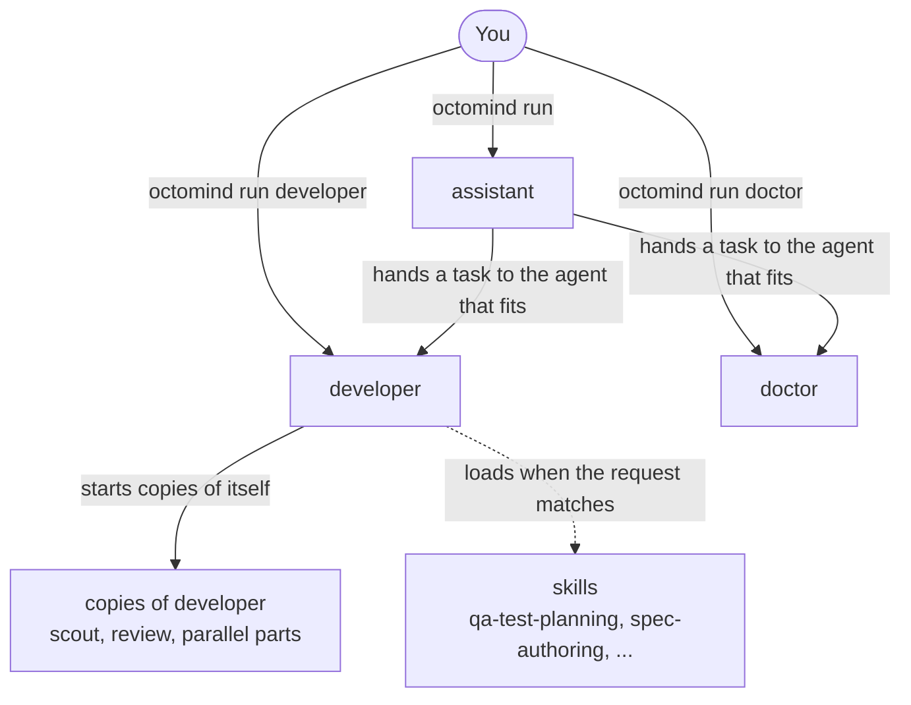

# Octomind Tap — Architecture & Design Decisions

This document captures the canonical design of the tap registry. Read this before making any changes.

---

## Core Principle: Capability-Based Manifests

**Agents declare capabilities, not MCP servers. This is mandatory. There is no other way.**

Forbidden:
```toml
[roles.mcp]
server_refs = ["core", "octofs", "octocode"]
allowed_tools = ["core:*", "octofs:*", "octocode:*"]
```

Required:
```toml
capabilities = ["core", "filesystem-read", "filesystem-write", "shell", "codesearch-semantic", "codesearch-structural", "codesearch-graph"]
```

`bin/load <name>` resolves capabilities at runtime and injects the full `[roles.mcp]` block automatically. Never write `[roles.mcp]` by hand in any manifest.

---

## How Capabilities Work

A **capability** is something an agent can do, achievable by different tools (providers).
Agents declare capabilities; the runtime resolves providers and injects dependencies.

Each capability name maps to `capabilities/<name>/default.toml` (a symlink to the active provider).
Users can override providers via `[capabilities]` in their config (e.g. `websearch = "brave"`).

Use prefix naming to group related capabilities: `programming-python`, `programming-rust`, etc.

```
agents/developer.toml
  └── capabilities = ["core", "filesystem-read", "filesystem-write", "shell", "codesearch-semantic", "codesearch-structural", "codesearch-graph", "programming-rust"]
           │
           ▼
  bin/load developer
           │
           ├── capabilities/core/default.toml              (built-in)
           ├── capabilities/filesystem/default.toml        → octofs.toml
           ├── capabilities/codesearch/default.toml        → octocode.toml
           └── capabilities/programming-rust/default.toml  → cargo.toml
           │
           ▼
  Merged manifest with [deps], [roles.mcp], [[mcp.servers]] injected
```

Each `capabilities/<name>/default.toml` is either:
- A **real file** (built-ins: `core`, `agent`) — no symlink needed
- A **symlink** pointing to the active provider (e.g. `default.toml → duckduckgo.toml`)

Symlinks are managed by `scripts/setup-symlinks.sh` which **always force-creates** them (`ln -sf`).

---

## Available Capabilities

| Capability     | Providers              | What it provides                                      |
|----------------|------------------------|-------------------------------------------------------|
| `core`         | default (built-in)     | `recall` (folded-context recall, only when attention compression is on); planning is not a tool: a plugin sets the plan — every agent declares it |
| `agent`        | default (built-in)     | `agent_*` — delegate to your own **configured** sub-agents |
| `orchestration`| default (built-in)     | `tap` (start copies of the agent, or run other agents matched to the task) + `schedule` (defer/recur loops) + `monitor` — **deliberate grant** |
| `runtime`      | octomind (built-in)    | `mcp` · `agent`-register · `skill` · `capability` — runtime tool-surface config (**high-trust**; only `octomind` declares it) |
| `filesystem-read`  | octofs                 | read files, list directories, search file contents (read-only) |
| `filesystem-write` | octofs                 | create, edit and delete files; several changes to one file in one call; copy line ranges |
| `shell`            | octofs                 | run shell commands                        |
| `codesearch-semantic`   | octocode               | `semantic_search` (natural-language code search) |
| `codesearch-structural` | octofs (also octocode) | file outlines, AST pattern search, symbol definitions and references (structural code search) |
| `codesearch-graph`      | octofs (also octocode) | a symbol's callers, callees, imports and type hierarchies (code relationship search) |
| `memory-read` / `memory-write` | octobrain | `remember` / `memorize`, `forget`              |
| `webfetch`     | octobrain              | `knowledge` — fetch URLs and local documents          |
| `websearch`    | duckduckgo (also brave, deepseek, exa, tavily) | `search` — web search                     |
| `versioning`   | git (default: octofs shell; alternate: `git.toml` MCP git server) | git operations                                        |
| `programming-python`  | uv               | Python runtime (uv, uvx)                              |
| `programming-rust`    | cargo            | Rust toolchain (cargo, rustc, clippy, rustfmt)        |
| `programming-nodejs`  | node             | Node.js runtime (node, npm, npx)                      |
| `docker`              | docker           | Docker CLI (docker, docker-compose)                   |
| `kubernetes`          | kubernetes       | Kubernetes CLI (kubectl, helm)                        |
| `svelte`              | svelte           | Svelte/SvelteKit documentation MCP server             |
| `medical-reference`   | medical          | medical references (PubMed, FDA, WHO, RxNorm)         |
| `market-data`         | yfinance         | financial data (Yahoo Finance)                        |

---

## Capability Access Tiers (least privilege)

Capabilities are grouped by **who needs the tool**. Each tier is its own built-in server with its own code module, so capability ⟷ server ⟷ module map 1:1 — `core` (`recall`), `orchestration` (`tap`, `schedule`, `monitor`), `runtime` (the tool-surface controls). An agent only gets the tiers its role declares.

| Tier | Capability | Tools | Who declares it |
|------|-----------|-------|-----------------|
| self-management | `core` | `recall` (a plugin sets the plan) | **every** agent |
| do the work | domain caps | `shell`, `filesystem-*`, `websearch`, `codesearch-*`, `legal-*`, … | per agent |
| own sub-agents | `agent` | `agent_*` | agents that run their own *configured* sub-agents (`assistant`, `developer`) |
| **orchestration** | `orchestration` | `tap`, `schedule`, `monitor` | agents that start copies of themselves; `assistant`, which also hands tasks to other agents |
| runtime config | `runtime` | `mcp`, `agent`-register, `skill`, `capability` | **high-trust only**; `octomind` |

**The rule — orchestration is for agents that intend to delegate.** An agent declares `core` + the tools its field needs. It declares `orchestration` only to start copies of itself (to scout or review read-only, or to split independent parts) or, for `assistant`, to hand tasks to other agents. Consult-style agents (a question in, an answer out) work in one session and do not declare it. `runtime` is declared only by `octomind`. This is enforced **structurally** — an undeclared tool is physically absent from the agent's context, not merely discouraged in the prompt. `tap`, `schedule` and `monitor` live on a separate built-in **`orchestration` server**, so an agent that declares `core` + `orchestration` resolves to `core:*` (`recall`) + `orchestration:*` (`tap`, `schedule`, `monitor`), while an agent that declares only `core` resolves to `core:*` (`recall`) alone — the orchestration server never enters its tool surface.

Agents that carry `orchestration` are listed by `grep -l orchestration agents/*.toml`. Only `assistant` carries a `# Uses:` header (see [Agents, Skills, and Delegation](#agents-skills-and-delegation)).

> `orchestration` (and `runtime`) may still **auto-activate** on intent — e.g. a request that clearly needs delegation or a recurring loop — via `capabilities/orchestration/config.toml` triggers. Auto-activation is request-driven and temporary; it never becomes part of an agent's standing grant.

---

## Agents, Skills, and Delegation

The tap has one agent per field of work, plus two special ones. A field agent does that field's work itself: `developer`, `writer`, `lawyer`, `doctor`, `producer`, and so on. `assistant` is the global assistant that hands tasks across fields. `plain` is a baseline with a one-line system prompt and no persona, used for prompt testing. Each agent is one manifest, `agents/<name>.toml`, and its tag is the file name. A tag has no `:`. An agent's prompt is short: role, scope, the common working method, guards and output conventions.

| Command | Runs |
|---------|------|
| `octomind run` | the config `default`, which is `assistant` |
| `octomind run developer` | the `developer` agent |
| `octomind run <name> --readonly` | that agent in a read-only session (see below) |

A role in the user's local Octomind config with the same name as a tap agent takes priority over the tap agent. A tag written with `:` is an error that shows the flat form.



### Skills carry the specialties

Each specialty procedure (QA test planning, contract review for one jurisdiction, lifecycle email) is a skill at `skills/<name>/SKILL.md`, bound to an agent by `domains: <agent name>`. A skill loads in four ways:

- automatically, when the user's message matches its `rules:`;
- from a workflow step that lists it in `skills = [...]`;
- from the environment: `OCTOMIND_SKILLS=a,b octomind run <name>`;
- by hand: `/skill use <name>`.

A skill can bring tools with it: `capabilities:` in its frontmatter loads them on activation. A tool that only one specialty needs is declared by that skill, not by the agent.

`session(<word>)` rule checks exist in Octomind, but a tap-run session is named `tap-<agent name>-<hex>`, so they cannot tell specialties apart. Tap skills use message checks.

### Delegation

An agent that declares the `orchestration` capability can delegate with the `tap` tool.

- Copies. The agent can start copies of itself: `role` set to its own name, or no `role` when it has no `# Uses:` header. Each copy is a fresh session of the same agent. `readonly: true` starts a read-only copy that scouts before a large change or reviews finished work independently. Several writable copies can run at once for independent parts, each on its own files. A copy cannot start further copies.
- Other agents. The `# Uses:` header is a header comment next to `# Title:` and `# Description:`: `# Uses: <entry>[, <entry>…]`. An entry is an agent name, or `*` for every other agent. The header sets which other agents this agent's `tap` runs can be matched to. An agent with the header declares `orchestration`. In this tap only `assistant` carries it, as `# Uses: *`: it is the one agent that hands tasks across fields.
- Matching. `tap` matches a task to an agent by comparing the brief with each reachable agent's `# Title:` and `# Description:`, so those headers must say the kind of work and the deliverable in the words a task brief would use.

```toml
# agents/assistant.toml
# Uses: *
```

The delegation tool describes matching, invocation, continuation, and asynchronous delivery in its tool definition. Use an agent's prompt for routing boundaries, work worth delegating, what the brief must carry, and how to verify the result. A 2026 MCP study found that compact tool descriptions can retain behavioral reliability in its evaluation. Evaluate the complete prompt and tool together on Octomind tasks. [MCP tool-description study](https://arxiv.org/abs/2602.14878v3) · [Joint tool and prompt optimization](https://arxiv.org/abs/2604.19821)

`{{CWD}}` and `{{DATE}}` change every session, which is why they stay banned from `system`.

### Read-only runs

`octomind run <name> --readonly` (also `octomind acp <name> --readonly`, and `readonly: true` on a `tap` run) starts a session in which only tools whose MCP `readOnlyHint` annotation is true are offered and executed. A tool with no hint counts as mutable. Shell runners declare `readOnlyHint: false`, so a read-only session has no shell. A read-only session cannot delegate.

### Choosing between a skill and an agent

- Add a skill for a procedure, subject technique, format, or checklist that an existing agent can apply with its own authority.
- Add an agent for a new field of work with its own deliverables and approval boundary.
- Keep work that depends on the same evidence in one session. Give a delegate the relevant source, constraints, authority, and acceptance checks. Split work at an independently verifiable boundary or an independent review.

### Built-in tap setting

In the Octomind config, the `[registry]` section names the built-in tap and the revision to serve: `tap = "muvon/tap"` is the built-in tap (always loaded last, after taps the user added) and `ref` names the branch, tag or commit of it to serve. Taps added with `octomind tap <user/repo>` follow their default branch.

### Model per agent

In the user's Octomind config, `[taps]` sets the model for one agent:

```toml
[taps]
"developer" = "openai:gpt-4o"
```

### Lint rules for agents

| Code | Fails when |
|------|------------|
| `AGENT_PATH` | the manifest is not at `agents/<name>.toml` |
| `AGENT_SUBDIR` | `agents/` contains a subdirectory |
| `AGENT_SYMLINK` | an agent file is a symlink |
| `AGENT_NAME_INVALID` | the file name does not start with a lowercase letter or is not lowercase letters, digits and hyphens (no `:`) |
| `MISSING_AGENT_HEADER` | the `# Agent: <name>` header is missing |
| `AGENT_HEADER_MISMATCH` | the `# Agent:` header differs from the file name |
| `DEFAULT_HEADER_REMOVED` | a manifest carries a `# Default:` header comment |
| `SPECIALISTS_REMOVED` | `{{SPECIALISTS}}` appears in `system` |
| `USES_PLACEHOLDER_REMOVED` | `{{USES}}` appears in `system` |
| `DOMAINS_REMOVED` | `{{DOMAINS}}` appears in `system` |
| `USES_INVALID` | a `# Uses:` entry is empty, malformed, repeated, or the agent itself |
| `USES_UNKNOWN` | a `# Uses:` entry has no `agents/<name>.toml` |
| `USES_CYCLE` | agents use each other in a loop; the message shows the loop |
| `USES_NO_ORCHESTRATION` | an agent with a `# Uses:` header does not declare `orchestration` |

`lint-skills` fails with `DOMAIN_UNKNOWN` when a skill's `domains:` entry is not an agent name. `lint-workflows` fails with `ROLE_FORMAT` when a step `role` contains `:`, and with `ROLE_NOT_FOUND` when it names no agent. It fails with `SKILL_NOT_FOUND` when a step preloads a skill that has no `SKILL.md`, and with `SKILL_DOMAIN_MISMATCH` when the skill's `domains:` does not include the step's `role` (a skill without `domains:` may be preloaded by any role). `lint-workflows` also fails with `READONLY_INVALID` when a step sets `readonly` to anything but `true` or `false`; `readonly = true` starts that step's agent with `--readonly`.

---

## Capability File Format

```toml
# capabilities/<name>/<provider>.toml
# Capability: <name>
# Provider: <provider-name>
# Title: <Short Capability Title (5–60 chars)>
# Description: <What this capability provides (20–160 chars)>

[deps]
require = ["muvon/octocode"]

[roles.mcp]
server_refs = ["octocode"]
allowed_tools = ["octocode:*"]

# Optional: [[mcp.servers]] if the provider needs a custom MCP server
[[mcp.servers]]
name = "octocode"
type = "stdio"
command = "octocode"
args = ["mcp"]
```

---

## Manifest Rules (non-negotiable)

1. **`capabilities = [...]` is mandatory** — every manifest must have it at the top level.
2. **Never write `[roles.mcp]`** in an agent — injected by `bin/load` from capabilities.
3. **Never write `[deps]`** in an agent — deps belong in capability files only.
4. **Never write `[[mcp.servers]]`** in an agent — MCP servers belong in capability files.
5. **Never set `name`** in `[[roles]]` — injected from the file name at runtime.
6. **One `[[roles]]` per file** — no multi-role manifests.
7. **File path is `agents/<name>.toml`** — directly under `agents/`, no subdirectories, no symlinks; the `# Agent:` header equals the file name; the name has no `:`.
8. **A `# Uses:` header needs `orchestration`** — an agent that lists other agents declares the capability that lets it delegate.

---

## Switching a Capability Provider

```bash
# Switch websearch from DuckDuckGo to Brave
ln -sf brave.toml capabilities/websearch/default.toml

# Reset all defaults
bash scripts/setup-symlinks.sh
```

`setup-symlinks.sh` behavior:
- Always **force-creates** symlinks (`ln -sf`) — never skips
- Reports `MISSING` + exits 1 if a provider `.toml` file doesn't exist
- Reports `WARN` for capability dirs with no mapping declared in the script

---

## Adding a New Capability

1. Create `capabilities/<name>/<provider>.toml` with `[deps]`, `[roles.mcp]`, optional `[[mcp.servers]]`
2. Add a `link "<name>" "<provider>.toml"` line to `scripts/setup-symlinks.sh`
3. Run `bash scripts/setup-symlinks.sh` to create the default symlink
4. Use `"<name>"` in any agent

To add an alternative provider to an existing capability:
1. Create `capabilities/<name>/<new-provider>.toml`
2. Users select it with `[capabilities] <name> = "<new-provider>"` in their Octomind config; manifests never name a provider

---

## bin/load

`bin/load <name>` (Python 3, no external deps):

1. Reads `agents/<name>.toml`
2. Extracts `capabilities = [...]`
3. For each capability, loads `capabilities/<name>/default.toml` (users switch providers in their own `[capabilities]` config, which `bin/load` does not read)
4. Merges: `[deps].require`, `server_refs`, `allowed_tools`, `[[mcp.servers]]` (deduplicated by name)
5. Strips `capabilities =` line from agent file
6. Injects merged `[roles.mcp]` (creates section if absent)
7. Outputs final TOML to stdout

---

## Skills

Skills are reusable instruction packs stored alongside agents in the tap. They follow the [AgentSkills specification](https://agentskills.io/specification).

### Directory layout

```
skills/
  <skill-name>/
    SKILL.md        # Required: YAML frontmatter + instruction body
    validate        # Optional: executable script — validates LLM output quality
    scripts/        # Optional: executable scripts the skill references
    references/     # Optional: supplementary docs (REFERENCE.md, etc.)
    assets/         # Optional: templates, config files, resources
```

### SKILL.md frontmatter

| Field | Required | Constraints |
|-------|----------|-------------|
| `name` | ✅ | Max 64 chars. Lowercase letters, numbers, hyphens. No leading/trailing hyphen. Must match directory name. |
| `title` | ✅ | 5–60 chars. Short human-readable label for the skill. |
| `description` | ✅ | 20–1024 chars. What the skill does and when to use it. |
| `capabilities` | optional | Capabilities to auto-load when skill activates. Space-delimited or array: `versioning memory-read` or `["versioning", "memory-read"]`. Names must match `capabilities/<name>/` directories. |
| `domains` | optional | Names of the agents the skill is bound to — each value must exactly match an existing `agents/<name>.toml` (runtime compares against the running agent's name). Space-delimited or array. Without this, skill is manual-only. |
| `rules` | optional | Auto-activation rules — list of expressions evaluated against the project and conversation. See [Auto-activation rules](#auto-activation-rules). |
| `license` | optional | License name or path to bundled license file. |
| `compatibility` | optional | Max 500 chars. Environment requirements (tools, OS, network). |
| `metadata` | optional | Arbitrary key-value mapping (author, version, tags). |
| `allowed-tools` | optional | Space-delimited pre-approved tools (experimental). |

### Activation: four methods

**Environment variable** — preload skills at session start:
```bash
OCTOMIND_SKILLS=programming-rust,git-workflow octomind run developer
```
Comma-delimited skill names. Activated permanently, no rules evaluated.

**Workflow step** — a step lists the skills it depends on with `skills = ["spec-authoring"]`; they load when the step starts.

**Auto-activation** — skills with a `rules:` frontmatter field are automatically evaluated on conversation events. The system scans skills whose `domains` include the current agent's name, evaluates their rules, and activates matching skills. Already-active skills (including env-loaded) are skipped.

**Manual activation** — the AI calls the `skill` MCP tool or user runs `/skill` command:

- `skill(action="use", name="<name>")` or `/skill use <name>` — inject skill into context
- `skill(action="forget", name="<name>")` or `/skill forget <name>` — remove skill
- `skill(action="list")` or `/skill list` — discover available skills

### Auto-activation rules

The `rules:` frontmatter field declares a list of expressions that determine when a skill should auto-activate. Rules are evaluated against the project working directory and the current conversation.

#### Logic: OR between items, AND within a single item

Each list item (`- ...`) is an **OR branch** — if any item matches, the skill activates.
Multiple expressions on the **same line** (space-separated) act as **AND** — all must match.

```yaml
rules:
  - content(rust)                 # OR: activates if user message contains "rust"
  - content(cargo)                # OR: activates if user message contains "cargo"
  - file(Cargo.toml) content(async)  # OR: activates if BOTH conditions are true
```

#### Rule expressions

| Expression | Matches when |
|------------|-------------|
| `file(<glob>)` | A file matching the glob pattern exists in the working directory. Supports `*` and `**`. Examples: `file(Cargo.toml)`, `file(*.rs)`, `file(src/**/*.go)` |
| `content(<word>)` | The user's message contains the word as a whole-word match (word-boundary aware, case-insensitive). Example: `content(rust)` matches "Rust" but not "rusty" |
| `match(<pattern>)` | The user's message matches the regular expression pattern. Example: `match(fix.*bug)` |
| `grep(<pattern>, <glob>)` | A file matching the glob contains a line matching the pattern. Example: `grep(tokio, Cargo.toml)`, `grep(use async_trait, src/**/*.rs)` |
| `env(<VAR>)` | The environment variable `VAR` is set (non-empty). Example: `env(CI)` |
| `env(<VAR>=<value>)` | The environment variable `VAR` equals `value`. Example: `env(NODE_ENV=production)` |
| `bin(<command>)` | The command is available in `$PATH`. Use to detect installed runtimes or tools. Example: `bin(cargo)`, `bin(docker)`, `bin(kubectl)` |
| `workdir(<pattern>)` | The current working directory path contains the pattern (substring match). Example: `workdir(projects/backend)`, `workdir(monorepo)` |
| `session(<word>)` | The current session name contains the word (case-insensitive substring). Default names are `YYMMDD-<dir>-HHMM-<id>`; sessions started by `tap run` are `tap-<agent name>-<hex>`, so the check cannot tell specialties of one agent apart. Tap skills use message checks. |

#### Full example

```yaml
rules:
  - content(rust) file(Cargo.toml)          # user mentions "rust" AND the project has a Cargo.toml
  - content(rust) content(async)            # user mentions both "rust" AND "async"
  - content(async) grep(tokio, Cargo.toml)  # user mentions "async" AND the project uses tokio
  - match(rewrite.*in rust)                 # user asks to rewrite something in Rust
  - content(compile) bin(cargo)             # user mentions "compile" AND cargo is installed
  - content(rustup) env(RUSTUP_HOME)        # user mentions "rustup" AND rustup is configured
  - content(backend) workdir(rust-projects) # user mentions "backend" AND the path contains "rust-projects"
```

Skills without `rules:` are manual-only — they never auto-activate.

### validate script

An executable file at `skills/<name>/validate`. Checks LLM output quality deterministically.

- `argv[1]` = event type: `user` | `assistant` | `turn`
- `stdin` = event content (user message, assistant response, or turn summary with tool names)
- **exit 0** = output is valid
- **exit non-zero** = invalid. stderr (or stdout if stderr empty) is captured and fed back to the LLM as an error message for correction.

### Capabilities auto-loading

When a skill declares `capabilities: versioning memory-read`, activating the skill resolves each capability from tap files (`capabilities/<name>/<provider>.toml`) and automatically loads the backing MCP servers.

### Agent binding

The `domains` field limits auto-activation to the named agents:

```yaml
domains: developer devops
```

Matching is an exact comparison against the running agent's name: `developer` matches `agents/developer.toml`. A value that is not an existing agent name silently never matches — the skill will never auto-activate (`DOMAIN_UNKNOWN` in the lint). Skills without `domains` are manual-only.

### Validation

```bash
# Lint all skills
bash scripts/lint-skills.sh

# Lint a specific skill
bash scripts/lint-skills.sh skills/git-workflow
```

The lint script validates:
- Valid YAML frontmatter (delimited by `---`)
- Required fields: `name`, `title`, `description`
- `name` format and length constraints
- `name` matches directory name
- `title` length (5–60 chars)
- `description` length (20–1024 chars) and `compatibility` length limits
- Non-empty body after frontmatter
- Every `reference/<file>` cited in the body exists
- `validate` script is executable if it exists

### Skill vs Agent

Skills and agents serve different purposes:

| | Skill | Agent |
|---|---|---|
| **File** | `skills/<name>/SKILL.md` | `agents/<name>.toml` |
| **Activation** | Manual via `skill` tool, or auto via `rules:` frontmatter field | `octomind run <name>` |
| **What it provides** | Domain knowledge + capabilities + validation | Full role: model, tools, system prompt |
| **Composable** | Yes — multiple skills per session | No — one role per session |
| **Tool access** | Can request capabilities when activated | Declares baseline capabilities. The runtime can activate additional capabilities on intent. |

### Choosing a role, skill, or workflow

Keep a role focused on a recognizable deliverable, its authority to act, and its baseline capabilities. Put reusable procedures, decision rules, examples, and output constraints in focused skills. Use a workflow to bind the input, skills, output, and checks for a repeatable job. Declare the required skills in the workflow step's `skills` field so activation has an explicit input.

Describe the work in the role prompt and put optional skill discovery in agent-bound frontmatter with task-specific descriptions and activation rules. Keep the role's essential output and permission checks in the prompt so a direct run remains useful when discovery abstains or is disabled. Mention an exact skill name in the prompt when the skill itself is the subject of the work or when an exact manual reference is part of the role's contract. Keep workflow skill dependencies in `skills`.

Before adding an agent, compare its authority, deliverables, callers, and behavior when no skill activates with those of an existing agent plus a skill. Name workflow roles and routing declarations by agent name. Check near-miss and unrelated inputs alongside intended activations. SkillRet finds that retrieval completeness drops as the number of required skills rises on its benchmark. Keep activation narrow and measure each required procedure's availability on representative tap tasks. [SkillRet, §5.3](https://arxiv.org/html/2605.05726v3#S5.SS3)

SkillsBench measures curated access and reports a mean gain of 16.6 percentage points across 87 tasks and 18 model–harness configurations. SkillRouter shows that name and description alone can omit routing information on its large-catalog retrieval benchmark. SkillBuffBench v2 separates automatic selection from curated access and presents the evaluation protocol. Measure discovery separately on tap workloads, including short direct requests, detached briefs, unrelated near-matches, and workflows with explicit preloads. [SkillsBench v4](https://arxiv.org/html/2602.12670v4) · [SkillRouter](https://arxiv.org/html/2603.22455) · [SkillBuffBench v2](https://arxiv.org/html/2611.22017v2)

The `promote` workflow shows the pattern: its `brief` step runs the `writer` agent with the `source-to-draft` skill, and its `draft` step runs the same agent with the `content-social` skill, so one agent covers both specialties.

Keep decisions that depend on the same evidence in one session. The `document` workflow derives one verified change list and uses it for the README, changelog, and release notes. Reserve separate sessions for independently verifiable work or an independent review with a concrete acceptance check. Give each delegate the relevant source evidence, shared decisions, and output contract, plus an authorized way to resolve missing inputs. Preserve valid early exits.

Use capability declarations for the tools a role needs to deliver its baseline job. As task-specific tooling becomes available, attach optional MCP access through capability-backed skills or explicit step capabilities. Keep the capability scope tied to the task and surface unavailable required tools before making decisions that depend on them.

Measure changes to an agent or skill on paired tasks with the model and inputs held fixed. Compare output correctness, missing or fabricated fields, tokens, wall time, and tool availability. Include failed and incomplete runs in the denominator. Measure explicit skill preload separately from automatic activation so discovery misses are visible.

Controlled enterprise SOP experiments show sensitivity to missing decision context, output contracts, and tool access, with substantial coordination costs. SkillsBench reports that results vary by task and that focused guidance outperformed comprehensive documentation in its observed length buckets. These results motivate the design and its evaluation on tap workloads. [Enterprise SOP study, §4](https://arxiv.org/html/2611.12953v1#S4) · [SkillsBench, Appendix F](https://arxiv.org/html/2602.12670v4#A6) · [Agent Systems Scaling](https://arxiv.org/abs/2512.08296)

### Agent Binding (skills do not reach across agents)

A skill belongs to the agent named in its `domains:` field and stays inside that agent's field. Concretely:

- **`domains:` is single-valued where possible.** `domains: marketer writer founder` couples one skill to three agents and is almost always wrong — pick the agent that owns this skill's deliverable.
- **`compatibility:` describes environment only.** Tools, OS, network requirements. Not "Pairs with X agent" — pairing is the delegating agent's responsibility.
- **The body does not name other agents.** If the work needs to continue elsewhere, describe it as a downstream concern owned by another field — without pinning a specific agent.

The reason: a skill that names downstream agents bakes routing decisions into instruction content, and those names go stale when composition changes. Keeping skills free of agent names lets the agent layer compose them freely without rewriting skill bodies. This is the same separation as capabilities — agents declare *what they need*, capabilities provide *how it's delivered*; skills encode *what to know inside one field*, and the agent decides *which skills to load*.

---

## CI / Validation

```bash
# Lint all manifests (TOML validity, required fields, title/description, no name= set)
bash scripts/lint-manifests.sh

# Lint all capabilities (TOML validity, title/description, MCP server description)
bash scripts/lint-capabilities.sh

# Lint all skills (frontmatter validity, required fields incl. title)
bash scripts/lint-skills.sh

# Validate capability resolution for all agents
bash scripts/validate-capabilities.sh

# Lint all dep scripts (headers + companion docs)
bash scripts/lint-deps.sh

# All five run in .github/workflows/lint.yml on every push/PR
```

The lint script skips the `server_refs` cross-check for capability-driven agents (those with `capabilities =` at top level), since MCP wiring is resolved at runtime.

---

## User-Tap Scaffold (`scaffolds/tap/`)

`octomind tap init <owner/name>` bootstraps a new user tap from `scaffolds/tap/`
in this repository (read from the installed default tap on the user's machine).
`scaffold.toml` is the render contract; everything under `root/` is copied after
`__TOKEN__` substitution in paths and contents, then validated with the
generated repo's own `scripts/check.sh`, git-initialized, and registered as a
local tap. See `scaffolds/tap/README.md` for the token table and renderer rules.

To avoid drift, shared files exist once: the repository's `templates/*` and
`deps/lib/platform.sh` are relative symlinks into `scaffolds/tap/root/`. The
renderer reads through symlinks, so generated taps always receive real files.

---

## Metadata Comments

All agents and capabilities require `# Title:` and `# Description:` comment lines:

| Entity | Field | Constraints |
|--------|-------|-------------|
| Agent | `# Title:` | 5–60 chars. Short human-readable label. |
| Agent | `# Description:` | 120–155 chars. What the agent does. |
| Capability | `# Title:` | 5–60 chars. Short capability label. |
| Capability | `# Description:` | 20–160 chars. What the capability provides. |

---

## Canonical Manifest Template

```toml
# agents/<name>.toml
# Agent: <name>
# Title: Short Agent Title
# Description: What this agent does, in 120–155 characters.

capabilities = ["core", "filesystem-read", "filesystem-write", "shell", "programming-python"]   # REQUIRED

[[roles]]
system = """
<identity>
You are a <persona> assistant.
</identity>
"""
welcome = """🔧 <Short greeting>.
<system>
Working dir: {{CWD}}
Current date: {{DATE}}
</system>"""   # {{CWD}}/{{DATE}} only here — in `system` they break prompt caching

# Optional: model override
# model = "<provider>:<model>"
```
