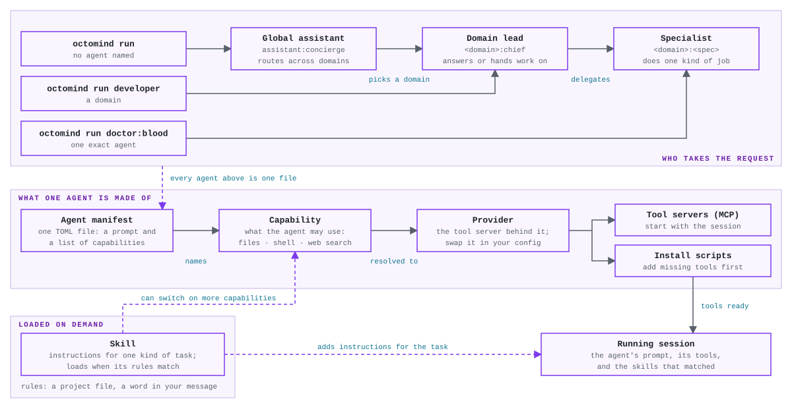

# Octomind Tap

> Run a fully-configured AI specialist with one command — no setup, no config files, no API plumbing.

The community registry for [Octomind](https://github.com/muvon/octomind), the CLI-first AI agent runtime. **34 agents**, 331 skill packs, 31 ready-made workflows, 160+ dependency scripts — defined in TOML and Markdown files that Octomind resolves and merges into your session at runtime.

```bash
octomind run                   # the global assistant
octomind run developer         # the developer agent: bugs, features, tests, specs, reviews
octomind run doctor            # the doctor agent: cited answers to health questions
```

Browse the catalog: [octomind.run/tap](https://octomind.run/tap/)

One diagram: who takes a request, what an agent file contains, and when skills load.

<picture>
  <source media="(prefers-color-scheme: dark)" srcset="assets/how-it-works-dark.svg">
  
</picture>

---

## Table of Contents

- [Quick Start](#quick-start)
- [Agents, Skills, and Delegation](#agents-skills-and-delegation)
- [What's in the Registry](#whats-in-the-registry)
- [Agent Names](#agent-names)
- [Capability System](#capability-system)
- [Workflows](#workflows)
- [Skills](#skills)
- [Dependency Scripts](#dependency-scripts)
- [Repository Layout](#repository-layout)
- [Contributing](#contributing)
- [License](#license)

---

## Quick Start

You need the `octomind` binary first — the tap ships with it as the default registry, so no tap registration is required.

```bash
# 1. Install Octomind (macOS & Linux) — single Rust binary, no runtime dependencies
curl -fsSL https://raw.githubusercontent.com/muvon/octomind/master/install.sh | bash

# 2. Sign in — models included, no API keys to manage
octomind login

# 3. Run an agent
octomind run doctor
```

The default tap is cloned automatically on first use and updated on every run.

```bash
# Run a ready-made multi-step pipeline
octomind workflow develop

# Bootstrap your own tap (private or team) — rendered, validated, ready to run
octomind tap init acme/team && octomind run team
```

---

## Agents, Skills, and Delegation

The tap has one agent per field of work: `developer`, `doctor`, `writer`, `lawyer`, `producer`, and so on. An agent does its field's work itself. Each specialty inside a field (QA test planning, contract review for one jurisdiction, lifecycle email) is a skill that loads when your request matches it. `assistant` is the global assistant and `plain` is a baseline with a one-line system prompt and no persona, used for prompt testing.

| Command | Runs |
|---------|------|
| `octomind run` | the global assistant, `assistant` |
| `octomind run developer` | the `developer` agent |
| `octomind run developer --readonly` | the `developer` agent in a session that offers only read-only tools (no shell, no delegation) |

Agents for work that splits into parts can start copies of themselves: a read-only copy to scout before a large change or to review finished work independently, or several writable copies for independent parts of a task. The global assistant also hands tasks to the agent that fits them; it declares that with the header comment `# Uses: *` in `agents/assistant/default.toml`. The rules and the lint codes are in [ARCHITECTURE.md](ARCHITECTURE.md#agents-skills-and-delegation).

---

## What's in the Registry

| Directory | What it holds | Count |
|-----------|---------------|-------|
| `agents/<ns>/default.toml` | Base agent manifests — a system prompt and capability declarations | 34 |
| `capabilities/<name>/` | Capability definitions — the tools an agent needs, decoupled from how they're provided | 70+ |
| `agents/<name>/skills/<skill>/SKILL.md` | Owned skills: instruction packs (AgentSkills spec) that one namespace uses and that auto-activate by context | 283 |
| `skills/<skill>/SKILL.md` | Shared skills: instruction packs used by two or more namespaces | 48 |
| `workflows/<name>.toml` | Multi-step pipelines chaining agent runs (sequential / parallel / loop / conditional) | 31 |
| `deps/<org>/<tool>.sh` | Dependency install scripts — auto-run before sessions, macOS + Linux | 160+ |
| `model/` | Embedding model fine-tune powering capability auto-activation | — |
| `bin/load` | The resolver: merges capabilities into the final manifest (stdout) | — |

The 34 agents:

| Agent | Title | What it does |
|-------|-------|--------------|
| `academic` | AI Research Assistant – Literature Reviews & Papers | An AI research assistant for literature reviews, research questions, thesis statements, paper drafts, abstracts, reviewer replies and citation checks. |
| `ai-engineer` | AI Engineer – LLM Apps, Evals, Red Teaming | Builds LLM and RAG apps, designs evals, red-teams prompts and agents, and classifies AI systems under the EU AI Act. Delivers specs, reports and memos. |
| `analyst` | AI Data Analyst – SQL, Pipelines & Spreadsheets | Answers data questions end to end: data analysis and statistics, SQL queries, warehouse pipelines, forecasting models, and Excel or Google Sheets formulas. |
| `assistant` | AI Personal Assistant – Everyday Tasks & Delegation | Does everyday work itself: inbox, meetings, writing, research, life admin, notes, task briefs. Hands specialist work to the agent that fits. |
| `chef` | AI Recipe Generator – Meal Plans & Grocery Lists | Suggests recipes from your ingredients, plans weekly meals with budget-capped priced grocery lists, scales recipes, and coaches technique with food safety. |
| `coach` | AI Coach – Goals, Career, Habits & Accountability | An AI life coach for goals and accountability, career and job search, resumes, interviews, negotiation, speaking, habits, fitness and wellbeing. |
| `community-manager` | Discord Server Setup & Moderation – Community Manager | Plans and runs online communities: Discord server setup blueprints, moderation rules and AutoMod packs, onboarding, engagement rituals and health audits. |
| `designer` | AI Design Assistant – UX Audits, Accessibility, Logos | An AI design assistant for UX audits and microcopy, WCAG and EAA accessibility audits, user research synthesis, usability test plans, logos and brand kits. |
| `developer` | AI Coding Assistant – Fix Bugs & Build Features | An AI coding assistant that fixes bugs, builds features and refactors, writes tests, specs, docs and changelogs, and reviews diffs in plain language. |
| `devops` | AI DevOps Engineer – Servers, Kubernetes, CI/CD | Fixes servers and infrastructure from logs and metrics: Linux, Docker, Kubernetes, Terraform, cloud IAM and cost, CI/CD, monitoring and incident response. |
| `doctor` | AI Symptom Checker – Health Info, Labs, Urgency | Explains symptoms by urgency, lab results, medications, nutrition, sleep and medical bills with cited evidence. Information, not diagnosis or advice. |
| `family-advisor` | AI Parenting Guide – Eldercare, Benefits, Bereavement | Family help: parenting from newborn to teen, aging-parent care, benefits paperwork and the weeks after a death. Checklists and next steps, not advice. |
| `financial-planner` | AI Bookkeeping & Budget Assistant – Debt, Tax, Retirement | Handles budgets and debt payoff, bookkeeping, student loans, personal tax, retirement, insurance claims, statement analysis. Education, not advice. |
| `founder` | AI Pitch Deck Generator – Idea to First Customers | Takes a product from idea to first customers: idea validation, go-to-market plan, brand, pitch deck, pricing, ads and investor outreach drafts. |
| `handyman` | AI Handyman – Home Repair & Maintenance Guide | Diagnoses home repairs with DIY-or-pro safety gates, walks through fixes, plans maintenance schedules and helps you hire and brief a contractor. |
| `hr` | AI HR Assistant – Hiring & People Operations | Runs hiring from scorecard to offer, plus onboarding, reviews, feedback scripts, performance plans and policies, with employment-law flags for counsel. |
| `lawyer` | AI Legal Assistant – Legal Research & Rights Info | Researches laws and statutes by country, explains rights, reviews contracts, and drafts demand letters for consumer and visa matters. Not legal advice. |
| `marketer` | AI Marketing Agent – Email, Growth, PR, Social | An AI marketing agent for founders and small teams: lifecycle emails and newsletters, growth plans, paid media setup, partner programs, PR and social. |
| `mechanic` | AI Mechanic – Car Warning Lights, Quotes, Used Cars | Triages car symptoms and warning lights, calls DIY versus mechanic, checks repair quotes, plans maintenance and builds used-car checklists. Safety first. |
| `merchant` | AI Ecommerce Assistant – Listings, Pricing, Orders | Handles seller-side ecommerce: product listings, pricing and margins, orders, refunds, marketplace accounts and store policies. Asks before any change. |
| `octomind` | Octomind Assistant – Config, Taps & Workflows | Answers Octomind CLI, config, runtime and Besydr questions, edits config.toml, builds tap agents, skills, capabilities, deps and workflow pipelines. |
| `operator` | AI Web Scraper & UI Automation – Browser, Desktop, Mobile | Drives web pages, desktop and mobile apps for browser automation: scrapes data, fills forms, runs flows, posts approved copy, returns files and step logs. |
| `plain` | Plain Assistant – System Prompt Baseline | Simple AI assistant with a one-line system prompt and no persona. Use it to chat with AI, run prompt testing, and compare models against a baseline. |
| `pm` | AI Product Manager – PRDs, Roadmaps, Status Reports | Turns ideas into PRDs, stories, RICE roadmaps and OKRs, and runs delivery as an AI project manager: milestone plans, RAID logs and RAG status reports. |
| `producer` | AI UGC Video Generator – Scripts, Ads, Edits, Uploads | AI video producer: scripts, storyboards, UGC and short-form ads, explainers, footage edits, podcast clips, thumbnails, uploads to TikTok, Reels, YouTube. |
| `sales-rep` | AI Sales Assistant – B2B Outreach, Proposals & CRM | B2B sales work: cold outreach copy, lead enrichment and scoring, discovery and qualification, closing and negotiation, RFP proposals, CRM and pipeline. |
| `security-analyst` | AI Cybersecurity Analyst – AppSec, SOC, Compliance | Defensive cybersecurity: secure code review, alert and phishing triage, incident response, GDPR and SOC 2 readiness, scam and identity-theft recovery. |
| `seo` | AI SEO Tool – Site Audits, Keywords, AI Visibility | Audits sites for technical, on-page and link problems, plans keyword research, content clusters and link building, and diagnoses visibility in AI answers. |
| `shopper` | AI Shopping Assistant – Product Research & Price Comparison | Compares products and prices across retailers, analyzes reviews, and suggests gifts for a person you describe. Honest trade-offs; no affiliate bias. |
| `support-agent` | AI Customer Service Agent – Ticket Triage & Success | Triages support queues, drafts replies for approval, files tickets, writes help articles and macros, scores account health, runs churn saves and renewals. |
| `travel-agent` | AI Travel Planner – Day-by-Day Itineraries & Road Trips | Builds day-by-day itineraries, road trips, budgets, transport logistics and packing lists, verifying prices and hours online. You book; it plans. |
| `tutor` | AI Tutor – Any Subject, Coding, Math, Languages | Tutors any subject, coding, math, languages and test prep with retrieval practice and Socratic hints, and drafts teacher lesson plans. Never ghostwrites. |
| `vet` | Dog Symptom Checker – AI Pet Health & Training Guide | Triages dog and cat symptoms with urgency tiers, toxin checks and home care, and coaches force-free training. Information, not a veterinary diagnosis. |
| `writer` | AI Writing Tool – Articles, Blogs, Social Posts, Slides | Writes and edits articles, blog posts, social posts, replies, fiction notes, translations and slide decks; audits drafts and publishes approved content. |

---

## Agent Names

An agent tag is `<ns>` or `<ns>:<variant>`. The base agent `agents/<ns>/default.toml` is started with `octomind run <ns>`; `<ns>:default` names the same agent. A variant `agents/<ns>/<variant>.toml` is started with `octomind run <ns>:<variant>`. Names are lowercase letters, digits and hyphens. This tap keeps one agent per field of work, so it has base agents only; variants are for private taps.

```
developer    → agents/developer/default.toml
devops       → agents/devops/default.toml
analyst      → agents/analyst/default.toml
```

A role in your own Octomind config with the same name as a tap agent takes priority over the tap agent.

---

## Capability System

Agents declare **what they need**, not how to get it. This is the only supported way — manifests never contain `[deps]`, `[roles.mcp]`, or `[[mcp.servers]]` blocks.

```toml
# agents/developer/default.toml

capabilities = ["core", "filesystem-read", "filesystem-write", "shell",
                "codesearch-semantic", "codesearch-structural", "versioning"]

[[roles]]
system = "..."
welcome = "..."
```

### How resolution works

1. `bin/load <name>` reads each capability → `capabilities/<name>/default.toml`.
2. `default.toml` is a symlink to the active provider (e.g. `octofs.toml`, `duckduckgo.toml`).
3. The resolver merges every provider's `[deps]`, `[roles.mcp]`, and `[[mcp.servers]]` into the final manifest on stdout.

### Capability highlights

| Capability | What it provides | Default provider |
|------------|-----------------|-----------------|
| `core` | `recall` — universal self-management (every agent); a plugin sets the plan | built-in |
| `agent` | `agent_*` — delegate to your configured sub-agents (declared by `assistant` and `developer`) | built-in |
| `orchestration` | `tap` (start copies of the agent, or hand a task to the agent that fits it) + `schedule` (defer/recur loops) + `monitor` | built-in |
| `runtime` | `mcp` · `agent`-register · `skill` · `capability` — runtime config (high-trust; only `octomind` declares it) | built-in |
| `filesystem-read` / `filesystem-write` | read files, list directories, search file contents / create, edit and delete files, copy line ranges | `octofs.toml` |
| `shell` | run shell commands | `octofs.toml` |
| `codesearch-semantic` | `semantic_search` | `octocode.toml` |
| `codesearch-structural` / `-graph` | file outlines, AST pattern search, symbol definitions and references / a symbol's callers, callees, imports and type hierarchies; `octocode.toml` as alternative | `octofs.toml` |
| `memory-read` / `memory-write` | persistent memory tools | `octobrain.toml` |
| `websearch` | web search | `duckduckgo.toml` |
| `versioning` | git operations via octofs shell (default); MCP git server as `git.toml` | `octofs.toml` |

Beyond these, the registry ships 50+ domain capabilities — `legal-*`, `video-gen`, `image-gen`, `messaging-*`, `trading-crypto`, and more. See [ARCHITECTURE.md](ARCHITECTURE.md) for the full table.

> **Access tiers (least privilege).** An agent declares `core` plus the tools its field needs. Only agents that start copies of themselves, and `assistant`, which also hands tasks to other agents, declare `orchestration`. Consult-style agents (a question in, an answer out) work in one session and do not. Only `octomind` declares `runtime`. A server that an agent does not declare is not in its tool set at all. See [ARCHITECTURE.md](ARCHITECTURE.md#capability-access-tiers-least-privilege).

### Switching providers

```bash
# Switch websearch from DuckDuckGo to Brave
ln -sf brave.toml capabilities/websearch/default.toml

# Or reset all defaults
bash scripts/setup-symlinks.sh
```

### Debugging resolution

```bash
# Inspect the fully merged manifest for an agent
bin/load developer

# Validate capability resolution for every agent in the registry
bash scripts/validate-capabilities.sh
```

---

## Workflows

Multi-step pipelines live outside agent manifests: portable TOML files that chain `octomind run` invocations — sequential, parallel, looping, or conditional — piping output between steps by name.

```bash
octomind workflow develop       # plan → implement → review pipeline
octomind workflow deep-review   # multi-lens code review
octomind workflow decode        # confusing bill/lease/letter → verified plain-language decode
octomind workflow launch        # product idea → go/no-go → go-to-market kit
```

31 ready-made workflows ship in `workflows/` — build, content, research, and everyday-life pipelines; see [workflows/README.md](workflows/README.md) for the full list. A step names an agent and, where it needs a specialty, preloads skills: `role = "developer"`, `skills = ["spec-authoring"]`. Author your own with the `octomind-workflow` skill or the `octomind` agent.

---

## Skills

Skills are reusable instruction packs ([AgentSkills](https://agentskills.io) spec) that carry one specialty of an agent — and activate themselves when the context matches.

```markdown
---
name: git-workflow
title: "Git Workflow"
description: "Git commit conventions, branch naming, and workflow best practices..."
license: Apache-2.0
compatibility: "Requires git. Works with any git-based project."
capabilities: versioning
domains: developer devops
rules:
  - file(.git)
---
```

- `rules:` predicates (`file()`, `match()`, `semantic()`, `grep()`, `env()`, …) drive auto-activation. Skills without `rules:` are manual-only.
- `capabilities:` auto-loads capabilities when the skill activates.
- `domains:` names the agent namespaces a shared skill is bound to; auto-activation applies only in those namespaces. An owned skill, one stored under `agents/<ns>/skills/`, belongs to that namespace by location, so its base agent and every variant get it, and it has no `domains:` line.
- An optional `validate` script alongside `SKILL.md` checks the agent's output.

Preload skills by name, wherever they are stored:

```bash
OCTOMIND_SKILLS=programming-rust,git-workflow octomind run developer
```

Skill auto-activation is powered by the embedding fine-tune in `model/` — see [model/README.md](model/README.md) for the training pipeline.

---

## Dependency Scripts

Capabilities can require external tools. Octomind runs the matching `deps/<org>/<tool>.sh` automatically before the session starts — exit non-zero aborts the session with a clear error.

```toml
# inside a capability file
[deps]
require = ["astral-sh/uv", "nodejs/node"]
```

Every dep script must:

1. **Source `deps/lib/platform.sh`** — all platform helpers come from there, never re-implemented
2. **Be idempotent** — exit 0 immediately if the tool is already installed
3. **Cover macOS + Linux** — brew on macOS; apt/dnf/pacman/zypper/apk + universal fallback on Linux
4. **Carry the required header** (parsed by tooling) and a companion `.md` doc:

```bash
# dep: astral-sh/uv
# type: dep
# description: Fast Python package installer and resolver
# check: uv
# https://docs.astral.sh/uv/
```

`type: mcp` marks scripts that exist to make an MCP server runnable; `type: dep` marks standalone CLI tools. The registry ships 160+ scripts — run `bash scripts/lint-deps.sh` to validate them.

---

## Repository Layout

```
agents/<ns>/default.toml         # Base agent — one directory per field of work
agents/<ns>/skills/<skill>/SKILL.md  # Owned skills: used by that namespace only
capabilities/<name>/            # Capability definitions
  default.toml                  # Symlink → active provider (e.g. octofs.toml)
  <provider>.toml               # [deps], [roles.mcp], [[mcp.servers]]
deps/<org>/<tool>.sh            # Dependency install scripts (+ companion .md)
deps/lib/platform.sh            # Shared platform detection helpers
skills/<skill>/SKILL.md         # Shared skills: used by two or more agents (AgentSkills spec)
workflows/<name>.toml           # Multi-step pipelines — octomind workflow <name>
model/                          # Embedding fine-tune powering capability auto-activation
bin/load                        # Resolver: merges capabilities → final manifest (stdout)
scripts/                        # Lint + validation tooling
templates/                      # Canonical templates for agents, skills, deps, capabilities
scaffolds/tap/                  # Source of truth for `octomind tap init` (new user taps)
ARCHITECTURE.md                 # Design doc — read before making changes
CONTRIBUTING.md                 # Contribution guidelines
```

### Taps

This repo is the **default tap** — always active, cloned to `~/.local/share/octomind/taps/`, auto-updated via `git pull` on every run. You can layer your own:

```bash
octomind tap myorg/agents                  # add a GitHub tap (checked before the default)
octomind tap myorg/agents /path/to/repo    # add a local tap (no clone)
octomind tap                               # list active taps
octomind untap myorg/agents                # remove a tap
```

### Create your own tap

One command bootstraps a private or public tap from the scaffold in
[`scaffolds/tap/`](scaffolds/tap/):

```bash
octomind tap init acme/team
```

This renders the scaffold into `./octomind-team/`, validates it, initializes
Git, and registers it as a local tap — the starter agent runs immediately:

```bash
octomind run team
```

Options:

```bash
octomind tap init acme/team --dir ../team-tap      # destination (default ./octomind-<name>; must be empty)
octomind tap init acme/team --agent ops            # starter agent's name (default: the tap name); the agent is agents/<name>/default.toml
```

The tap id `owner/name` maps to the GitHub repository `owner/octomind-<name>`.
Pick a name whose repository does not exist yet and that does not shadow an
active tap (`octomind tap` lists them; `muvon/tap` is the built-in default).

`init` creates no remote and pushes nothing. To publish, create the repository
and push from the generated directory:

```bash
gh repo create acme/octomind-team --private --source . --remote origin
git add -A && git commit -m "chore: scaffold tap"
git push -u origin HEAD
```

On other machines, add it with `octomind tap acme/team`. That command clones
`github.com/acme/octomind-team`, so a private repository needs Git access
(SSH key or `gh auth login`).

The scaffold is read from the installed default tap, not from a local checkout
of this repository. `scaffolds/tap/` here is the single source of truth for the
generated layout; any GitHub template repository is only a synchronized mirror.

### Placeholder variables

Manifests support placeholders expanded at runtime — run `octomind vars` to see them all:

| Placeholder | Behaviour |
|-------------|-----------|
| `{{INPUT:KEY}}` | Prompts once, stores in `~/.local/share/octomind/inputs.toml` — for global secrets (API tokens) |
| `{{ENV:KEY}}` | Reads the environment; if unset, prompts and saves to `./.env` — for project-scoped values |
| `{{CWD}}`, `{{DATE}}`, … | Runtime context — use in `welcome` only, never in `system` (breaks prompt caching) |

---

## Contributing

**The most valuable contribution is expertise, not code.** If you have domain knowledge — medicine, law, finance, security, DevOps — you can ship a skill that makes an agent better at your field, or an agent for a field the tap does not cover yet.

```bash
# 1. Start from the canonical template
mkdir agents/<name>
cp templates/agent.toml agents/<name>/default.toml

# 2. Edit: capabilities and the system prompt (XML-tagged blocks)

# 3. Validate
bash scripts/lint-manifests.sh agents/<name>/default.toml
bash scripts/validate-capabilities.sh
bin/load <name>
```

Key rules:

- Agents declare `capabilities = [...]` only — never `[deps]`, `[roles.mcp]`, or `[[mcp.servers]]` in a manifest
- System prompts use XML-tagged blocks in canonical order (`<identity>` → … → `<critical>`), 200–1000 words
- Exactly one `[[roles]]` entry; never set `name` (injected at runtime from the tag)
- New capabilities need a provider file, a `setup-symlinks.sh` entry, and a `DECLARED` registration

Full guidelines: [CONTRIBUTING.md](CONTRIBUTING.md) · Design doc: [ARCHITECTURE.md](ARCHITECTURE.md) · Agent conventions: [AGENTS.md](AGENTS.md)

---

## License

Apache 2.0 — see [LICENSE](LICENSE).

**Octomind** by [Muvon](https://muvon.io) | [Website](https://octomind.run) | [Documentation](https://octomind.run/docs/)
